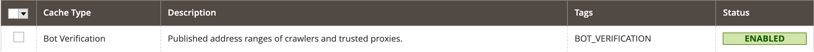
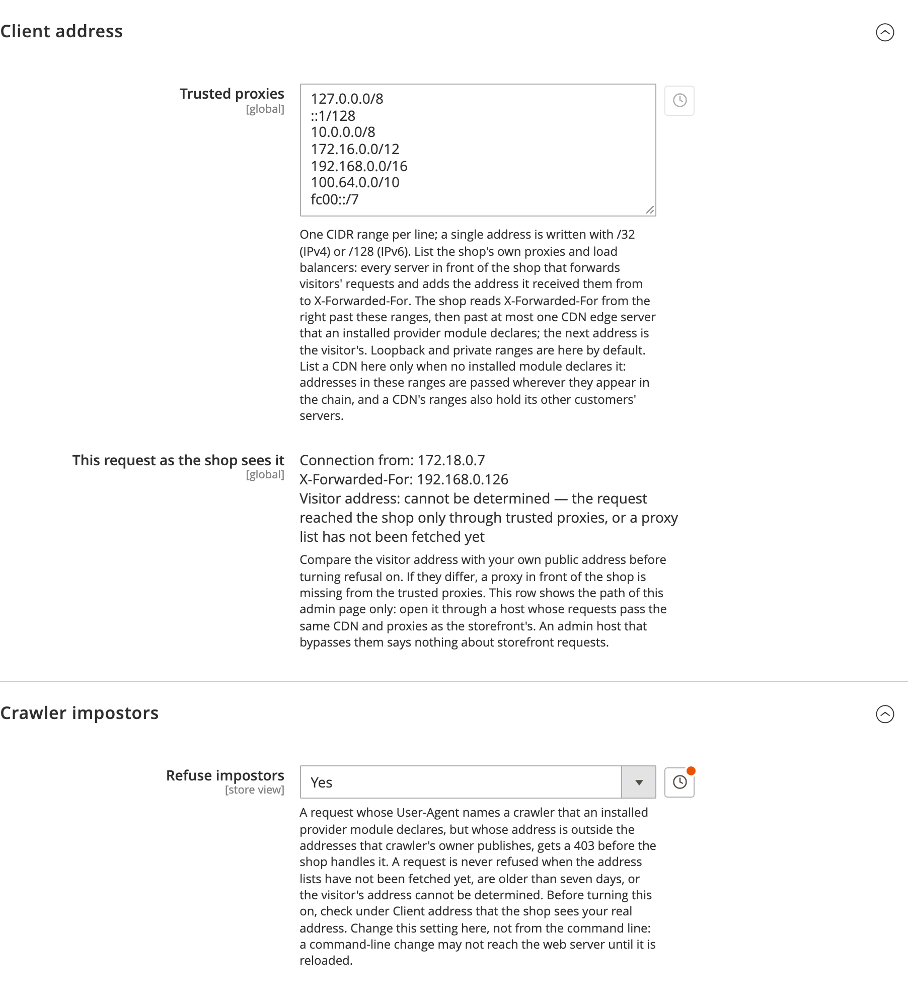

# Magento 2 Bot Verification

Catches requests that call themselves Googlebot or bingbot but come from an address the crawler's owner does not
publish, and answers them with a 403 before Magento routes them.

Anyone can put `Googlebot` in a User-Agent, and shops often let such requests skip captchas and bot filters. Google
and Bing publish the address ranges their crawlers use. This module fetches those lists, stores them in the database,
serves them from the Magento cache and checks every request that claims a crawler against them. It runs in PHP, so it
works on shops without Cloudflare rules or access to the web server's configuration.

## Packages

| Package | Module | Adds |
|---|---|---|
| `hryvinskyi/magento2-bot-verification` | `Hryvinskyi_BotVerification` | The check, the refusal, the address lists and their refresh, the admin settings and the CLI commands |
| `hryvinskyi/magento2-bot-verification-google` | `Hryvinskyi_BotVerificationGoogle` | Google's crawlers and fetchers and their five address lists |
| `hryvinskyi/magento2-bot-verification-bing` | `Hryvinskyi_BotVerificationBing` | bingbot and its address list |
| `hryvinskyi/magento2-bot-verification-cloudflare` | `Hryvinskyi_BotVerificationCloudflare` | Cloudflare's edge servers as trusted proxies; install it only on a shop behind Cloudflare |

The provider packages hold configuration only. With none installed, the core recognises no crawler and refuses
nothing.

The metapackage [`hryvinskyi/magento2-bot-verification-pack`](https://github.com/hryvinskyi/magento2-bot-verification-pack)
requires the core, Google and Bing packages, and leaves Cloudflare out.

## How a request is judged

1. One regular-expression pass over the User-Agent finds every crawler it names. A browser names none, and its request
   is done here.
2. The visitor's address is read from `X-Forwarded-For`, right to left, starting at `REMOTE_ADDR`. The walk steps over
   the shop's own proxies (loopback and private ranges by default), then over at most one CDN edge server that a
   provider module declares, and the next address is the visitor's. Entries further left are written by the client and
   never read. Stepping over only one edge server stops a CDN customer's own code from forging the header through the
   CDN.
3. The address is checked against every list of the claimed crawler. The verdict is `genuine` when the address is in
   one of them. It is `impostor` when the address is public, every list has been fetched, at least one list covers the
   address's family (IPv4 or IPv6), none of those is older than 7 days, and the address is in none of them. Anything
   else is `unverifiable`: a list never fetched or out of date, a private address, a visitor address that cannot be
   determined. A request that claims no crawler gets `none`, and one that names several crawlers gets the worst of
   their verdicts.
4. With *Refuse impostors* on, an impostor gets a 403 and Magento never routes the request. Every other verdict passes.

Missing or stale lists, an unknown visitor address, a broken provider configuration and any error let the request
through: a fault stops the module from catching impostors rather than blocking anyone. The one setup that does refuse
real crawlers is a proxy with a public address in front of the shop that is not in the trusted proxies, because its
address is then taken for the visitor's; check for it before turning refusal on (see Configuration). Nothing on the
request path waits for the network. A cron job fetches the lists every 6 hours, and the CLI fetches them on demand.

## Installation

```bash
composer require hryvinskyi/magento2-bot-verification \
    hryvinskyi/magento2-bot-verification-google \
    hryvinskyi/magento2-bot-verification-bing
# behind Cloudflare, also:
composer require hryvinskyi/magento2-bot-verification-cloudflare

bin/magento module:enable Hryvinskyi_BotVerification Hryvinskyi_BotVerificationGoogle Hryvinskyi_BotVerificationBing
bin/magento setup:upgrade
bin/magento cache:enable bot_verification
bin/magento bot-verification:refresh
```

Magento leaves a new cache type disabled until it is enabled by hand. Without `cache:enable bot_verification` every
request that claims a crawler reads the lists from the database, three to four times slower (see Performance), and
`bot-verification:status` exits non-zero.



## Configuration

*Stores › Configuration › Hryvinskyi › Bot Verification*



*Trusted proxies* (global) holds one CIDR range per line: the shop's own proxies and load balancers, every server in
front of the shop that adds the address it received a request from to `X-Forwarded-For`. The defaults are
`127.0.0.0/8`, `::1/128`, `10.0.0.0/8`, `172.16.0.0/12`, `192.168.0.0/16`, `100.64.0.0/10` and `fc00::/7`. Add a CDN
here only when no provider module declares it, because addresses in this list are passed wherever they appear in the
chain.

*This request as the shop sees it* shows the connecting address and `X-Forwarded-For` of the admin page you are on,
and the visitor address the module resolves from them. It must show your own public address. If it shows a proxy's
address, that proxy is missing from the trusted proxies, and with refusal on every crawler behind it would be refused.
The screenshot comes from a local Docker setup whose only hops are private, so no visitor address can be determined
and nothing would be refused. The row describes the admin page's own path: when the admin host bypasses the CDN or
proxies the storefront uses, check the storefront path with `bot-verification:check --forwarded-for` (below).

*Refuse impostors* (store view) is off by default. Change it in the admin: on hosts that serve configuration from
opcache, a change made from the command line may not reach PHP-FPM until it is reloaded.

## Command line

`bot-verification:refresh [--force] [<list code>...]` fetches the lists now, all of them when no code is given. A list
that cannot be fetched, is not in its format, holds a malformed prefix or shrank to under half of its stored ranges
keeps its previous copy and is reported, and the command exits non-zero. `--force` accepts a shrink.

```
bing: 27 ranges
cloudflare_ipv4: 14 ranges
cloudflare_ipv6: 7 ranges
google_common: 36 ranges
google_special: 17 ranges
google_user_triggered: 110 ranges
google_user_triggered_google: 37 ranges
google_user_triggered_agents: 6 ranges
```

`bot-verification:status` shows each list's size and age and the cache type's state. It exits non-zero while a list is
missing or older than 7 days, or the cache type is disabled, so it can drive a monitoring check.

```
bing: 27 ranges, fetched 0 h ago
cloudflare_ipv4: 14 ranges, fetched 0 h ago
...
google_user_triggered_agents: 6 ranges, fetched 0 h ago
Maximum age: 7 days
Cache type bot_verification: enabled
```

`bot-verification:check <address> <User-Agent> [--forwarded-for <chain>]` prints the verdict a request would get.
With `--forwarded-for` the address is `REMOTE_ADDR`, and the visitor is resolved from the chain the way a live request
is, so a line copied from the web server's log checks the storefront path.

```
$ bin/magento bot-verification:check 127.0.0.1 'Mozilla/5.0 (compatible; Googlebot/2.1; +http://www.google.com/bot.html)' \
    --forwarded-for '203.0.113.9, 172.68.159.52, 127.0.0.1'
Client address: 203.0.113.9
Verdict: impostor
Crawler: google
```

## What a request gets

Requests to a Magento 2.4.9 shop with refusal on, sent through its web server with `REMOTE_ADDR` 127.0.0.1 and the
visitor in `X-Forwarded-For`, the way a reverse proxy hands them over:

| Request | Response |
|---|---|
| Googlebot User-Agent from 203.0.113.9 | 403 |
| Googlebot User-Agent from 66.249.66.1 (Google) | 200 |
| bingbot User-Agent from 157.55.39.1 (Microsoft) | 200 |
| bingbot User-Agent from 203.0.113.9 | 403 |
| bingbot User-Agent over IPv6 (Bing publishes IPv4 ranges only) | 200 |
| Firefox from 203.0.113.9 | 200 |
| Googlebot User-Agent behind private proxies only | 200 |

The headers the refusal sets:

```
HTTP/1.1 403 Forbidden
Content-Type: text/plain; charset=UTF-8
Cache-Control: max-age=0, must-revalidate, no-cache, no-store, private

Forbidden
```

`private` keeps the 403 out of shared caches, including a cache that turns every response not marked private into a
short public one.

## Performance

Measured on an AMD Ryzen 9 7950X with opcache and PCRE JIT, through Magento's object manager without compiled DI
metadata, as the best of 5 runs of 2,000 to 200,000 iterations each. Two installations: Magento 2.4.9 on PHP 8.4 with
the file cache, and Magento 2.4.6 on PHP 8.1 with Redis. Times are per call.

| Step | 2.4.9 · PHP 8.4 · file | 2.4.6 · PHP 8.1 · Redis |
|---|---|---|
| Refusal off: read the switch | 0.94 µs | 1.36 µs |
| Scan a browser User-Agent | 0.27 µs | 0.25 µs |
| Scan a Googlebot User-Agent | 0.78 µs | 0.75 µs |
| Look an address up in Google's 36 crawler blocks | 0.23 µs | 0.25 µs |
| Same lookup, looping over the 170 published IPv4 prefixes | 19.0 µs | 17.6 µs |
| Look an address up in the 110 blocks of the largest list | 0.25 µs | 0.25 µs |
| Same lookup, looping over its 534 published IPv4 prefixes | 60.7 µs | 57.1 µs |
| Resolve the visitor behind a CDN edge | 2.06 µs | 1.99 µs |
| Verdict for a Googlebot impostor (4 lists) | 4.17 µs | 4.16 µs |

A whole request, with every object built fresh as in PHP-FPM:

| Request | 2.4.9 · PHP 8.4 · file | 2.4.6 · PHP 8.1 · Redis |
|---|---|---|
| Browser | 14 µs | 14 µs |
| Real Googlebot behind a CDN (2 cache reads) | 75 µs | 94 µs |
| Googlebot impostor behind a CDN (5 cache reads) | 128 µs | 167 µs |
| Googlebot impostor, cache type disabled (5 database reads) | 465 µs | 506 µs |
| Memory held by the objects and the lists they read | 8.2 KB | 9.6 KB |

End to end through nginx and PHP-FPM on Magento 2.4.9 in developer mode with the built-in page cache, median of 90
requests interleaved over three rounds:

| Request | Refusal off | Refusal on |
|---|---|---|
| Firefox, page-cache hit | 25.4 ms | 25.7 ms |
| Real Googlebot, page-cache hit | 25.6 ms | 26.0 ms |
| Googlebot impostor, page-cache hit | 25.3 ms | 24.3 ms (403) |

The medians differ by 0.3 to 0.4 ms, inside a 10th-to-90th-percentile spread of 2.3 to 3.5 ms. On a page-cache miss
the difference is the render: the home page took 102.5 ms for Firefox and 24.4 ms for a refused impostor (medians of
25).

The lists are stored as packed binary ranges, sorted and merged, and searched by binary search without building an
array, which makes a lookup 70 to 240 times faster than looping over the published prefixes. Google's crawler list
packs to 480 bytes, and all eight lists take 4,544 bytes in the cache. With refusal off nothing behind the switch is
built. A request that claims no crawler pays for building the crawler registry and one pattern scan, and never touches
the cache or the visitor address. Each list a request needs is read from the cache once, and requests a page cache in
front of PHP answers never reach the module.

## Adding a crawler or a CDN

A provider module is a `di.xml` that adds items to the registry:

```xml
<type name="Hryvinskyi\BotVerification\Model\Crawler\CrawlerRegistry">
    <arguments>
        <argument name="rangeLists" xsi:type="array">
            <item name="example_list" xsi:type="string">https://example.com/crawler.json</item>
            <item name="example_edge" xsi:type="string">https://example.com/edge-servers.txt</item>
        </argument>
        <argument name="crawlers" xsi:type="array">
            <item name="example" xsi:type="array">
                <item name="tokens" xsi:type="array">
                    <item name="examplebot" xsi:type="string">ExampleBot</item>
                </item>
                <item name="lists" xsi:type="array">
                    <item name="example_list" xsi:type="string">example_list</item>
                </item>
            </item>
        </argument>
        <argument name="rangeListFormats" xsi:type="array">
            <item name="example_edge" xsi:type="string">plain_text</item>
        </argument>
        <argument name="proxyLists" xsi:type="array">
            <item name="example_edge" xsi:type="string">example_edge</item>
        </argument>
    </arguments>
</type>
```

A list is read as `{"prefixes": [{"ipv4Prefix": …}, {"ipv6Prefix": …}]}`, the format Google, Bing, Apple and DuckDuckGo
publish, unless `rangeListFormats` names another; `plain_text` reads one prefix per line. A new format is a class
implementing `PrefixListParserInterface`, added to the `parsers` argument of
`Hryvinskyi\BotVerification\Model\Source\HttpRangeListFetcher`. Codes are lower-case letters, digits and underscores.
A malformed declaration fails loudly in the refresh, the CLI and tests, and fails open on storefront requests.

## Limits

- Only crawlers whose owners publish address lists can be verified. There is no reverse-DNS check, because waiting for
  DNS on the request path would let a scraper tie up PHP-FPM workers.
- If the origin server can be reached around the CDN, a CDN customer's code that calls it directly is taken for the
  edge server, and the address it writes into `X-Forwarded-For` is read as the visitor's. That lets an impostor through
  and never refuses a real crawler. Requiring the CDN's client certificate at the origin (Cloudflare's Authenticated
  Origin Pulls) closes it.
- An edge range a CDN adds between two refreshes resolves to the edge server itself until the next refresh, so a real
  crawler arriving through it could be refused in that window.
- The switch is read before routing, so a REST or GraphQL request that names another store reads the switch of the
  store its host resolves to.

## Requirements

PHP 8.1 or later and `hryvinskyi/magento2-base` 2.2 or later. Verified on Magento 2.4.6 with PHP 8.1 and Magento
2.4.9-beta1 with PHP 8.4.

## License

MIT
